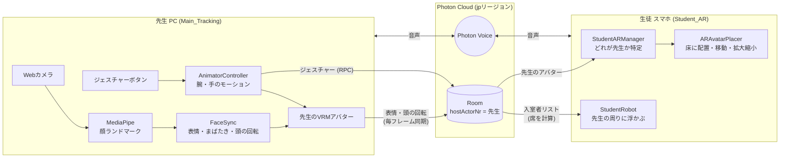

# Anywhere Sensei

Webカメラだけで先生の表情・頭の動きをリアルタイムにトラッキングし、ネットワーク越しに同期したVRMアバターとして、生徒側はスマホのARでその場にいるかのように見られる — というUnity製の遠隔授業向けプロトタイプです。先生と生徒はボイスチャットで会話でき、参加中の生徒は先生の周りに浮かぶ小さなロボットとして表示されます。

## 開発について

AIを活用して開発しています。
方針の決定、動作確認、デバッグは自分で行っています。

## デモ

https://github.com/user-attachments/assets/f28db377-0aa9-4813-a579-acfdd0134cca

PC（先生）側とスマホ（生徒・AR）側を並べたデモ動画です。両側は別々に収録したため映像同士のタイミングは同期していませんが、実際の接続では顔の動き・ジェスチャー・音声がリアルタイムで同期します。

## できること

### 先生(PC / `Main_Tracking`)
- **顔トラッキング**: Webカメラ映像から [MediaPipeUnityPlugin](https://github.com/homuler/MediaPipeUnityPlugin) で顔のランドマークを抽出し、表情(あいうえお・笑顔・驚き・怒り)・まばたき・頭部の回転をVRMアバターに反映
- **ジェスチャー**: 画面下のボタンから拍手・バイバイ・ポーズを再生。Mixamoから取り込んだHumanoidモーションをAnimator Controller + Avatar Maskで腕/手だけに適用し、顔トラッキング(頭部)や呼吸ゆらぎ(胸/肩)と競合しないように分離。再生はRPCで全員に配り、再生中のボタンはハイライトされる
- **呼吸ゆらぎ**: 胸・肩をPerlinノイズで揺らし、静止していても生きている感じを出す

### 生徒(Android / ARCore / `Student_AR`)
- **AR配置**: 認識した床の画面中央に「ここに立つ」目安の輪を出し、タップでその位置に先生を配置。ARAnchorで床に固定し、ARCoreが床の推定を後から修正してもアバターが追従する
- **配置後の操作**: 1本指ドラッグで床の上を移動 / ピンチで拡大縮小 / ダブルタップで等身大に戻す。先生は常にカメラ(=自分)の方を向く
- **生徒ロボット**: 参加している生徒は先生の周りの席に浮かぶロボットとして全員の画面に表示される。色は生徒ごとに自動で割り当て、喋っている間は目が光る
- **操作の案内**: 「床を映す → 輪をタップ → 先生を待つ → 操作方法」と、今やるべきことを画面上部に表示

### 共通
- **ネットワーク同期**: [Photon PUN 2](https://www.photonengine.com/pun) でトラッキング結果・ジェスチャー・生徒の入退室を同期
- **ボイスチャット**: Photon Voice 2。マイクのミュートは送信だけを止めるので、解除したときにマイクの再初期化待ちが無い
- **UI**: 配色・フォント・角丸画像を1つのテーマアセットにまとめたデザイントークン方式。接続状態(Connecting / Live / Offline)を常に表示し、スマホではノッチ等のセーフエリアに対応

## アーキテクチャ

UIはどちらの画面も、テーマアセット (`UITheme`) をもとにエディタ拡張 (`Editor/UIBuilder.cs`) がCanvasを組み立てる。

## 設計で工夫したこと

- **「教師は誰か」問題**: `PhotonNetwork.MasterClient` ではなく Room の Custom Property (`hostActorNr`) で教師を判定。ARの生徒がホストより先にルームへ参加/作成し得るケースを考慮した設計。
- **同期しない席決め**: 生徒ロボットの席は、全員が同じ入室者リストを持っていることを利用して各端末がローカルに計算する。位置を送らなくても全員の画面で同じ並びになる。
- **再現できるUI**: Canvasを手作業で組まず、エディタ拡張(`AnywhereSensei > UI` メニュー)がテーマアセットから画面を組み立てる。色を変えたいときはテーマ1つを直せば全画面に反映され、レイアウトを直したらメニューを実行し直すだけで同じ状態に作り直せる。

## 開発中に直面した問題と解決

- **回転同期の隠れバグ**: `FaceSync.cs` の `OnPhotonSerializeView` が送受信していたフィールドと、実際に `Update()` で参照しているフィールドが一致しておらず、頭部回転がリモートクライアントに一切反映されない状態が長く続いていた。フィールド名の一致だけでは検知できない典型的な同期バグ。
- **PUNコールバックの罠**: `MonoBehaviourPunCallbacks` を継承したクラスが `override` なしで独自の `OnEnable`/`OnDisable` を定義すると、PUNのコールバック登録自体が黙って上書きされ、接続は成功しているのに `OnJoinedRoom` などが一切発火しなくなる。原因特定にIL2CPPビルドキャッシュ破損を疑うなど遠回りしたが、最終的にコード側の問題と判明。
- **同じ部屋名なのに会えない**: Photonのリージョンを自動にしていると端末ごとに一番Pingの近いサーバーを選ぶため、PCは `jp`、スマホは `rue`(ロシア東部)のように分かれ、同じ部屋名でも別々の部屋に入っていた。リージョンを固定して解決。
- **1秒ごとのカクつき**: Webカメラを1280幅で取り込むと、約1秒周期でトラッキングが止まりカメラのLEDが点滅した。フレームレート上限なしで読み取りが詰まっていたのが原因で、取り込み幅を640に下げ、`targetFrameRate` を60に固定して解消。
- **AnimatorレイヤーとFaceSyncの競合**: Animatorの評価は `Update()` の後・`LateUpdate()` の前に走るため、フルボディのMixamoモーションをそのまま流すとMediaPipe由来の頭部回転を毎フレーム上書きしてしまう。Avatar Maskで腕/手/指のみに範囲を絞ることでコード変更なしに解決。

## 技術スタック

- Unity 2022.3.62f3 / URP
- [MediaPipeUnityPlugin](https://github.com/homuler/MediaPipeUnityPlugin)(顔トラッキング)
- Photon PUN 2 (v2.52)(ネットワーク同期) / Photon Voice 2(ボイスチャット)
- AR Foundation 5.2 / ARCore(Android AR)
- UniVRM 1.0(VRMアバターの読み込み・制御)
- uGUI + TextMesh Pro(UI。フォントは [Inter](https://rsms.me/inter/)、アイコンは Font Awesome Free)

## セットアップ

1. Unity 2022.3.62f3 でプロジェクトを開く
2. **先生側**: `Assets/Scenes/Main_Tracking.unity` を実行し、Webカメラで顔トラッキングを開始
3. **生徒側**: `Assets/Scenes/Student_AR.unity` をAndroid(ARCore対応端末)向けにビルドして起動。床を映して輪が出たらタップで先生を配置
4. 先生・生徒とも起動すると自動で同じPhotonルームに入る

### UIを作り直すとき

メニュー `AnywhereSensei > UI` から実行する。

1. `Generate Theme Assets` — フォント(SDF)・角丸画像・`Assets/UI/UITheme.asset` を生成(初回のみ)
2. `Build Teacher UI` / `Build Student UI` — 対象のシーンを開いてから実行。Canvasの中身をテーマに沿って作り直し、シーンを保存する

## 今後やりたいこと

- Mixamoモーションの追加によるジェスチャーの拡充、モーションをリッチに
- 手・腕のトラッキング(MediaPipeで一度試作したが見送り、現在はボタンからのジェスチャーで代替)
- 生徒側から先生へのリアクション(挙手・拍手など)
